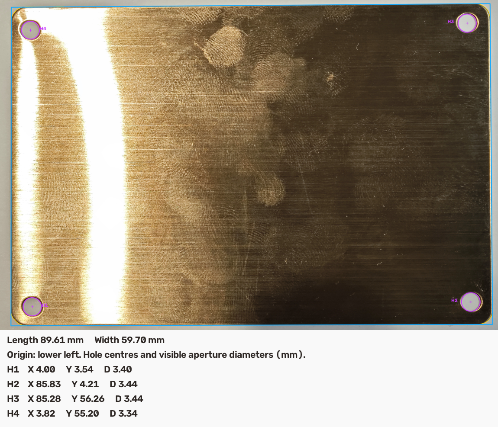

# 基于图像的平面零件尺寸测量

这是一套用手机照片测量四孔圆角板的 Python 桌面程序。将零件与直尺拍在同一张照片中，在界面上点选两条刻线并框住零件，程序即可给出板长、板宽、四个可见孔口的直径和孔心坐标，单位为毫米。每一步的处理图都会保存，便于检查程序究竟沿哪一圈边缘测量。



## 在 Windows 上启动

在项目根目录打开 PowerShell。若已有带 Tkinter、NumPy 和 OpenCV 的 Python 3 环境，可以直接双击 [start.cmd](start.cmd)。首次安装可使用独立环境：

```powershell
python -m venv .venv
.\.venv\Scripts\python.exe -m pip install numpy opencv-python
.\.venv\Scripts\python.exe ruler_app.py
```

启动器会显示选中的 Python 路径。在 PowerShell 中运行 `.\start.cmd --check` 可以单独检查环境。若提示缺少依赖，使用上面同一个解释器安装并启动；若缺少 `tkinter`，请为该 Python 安装 Tcl/Tk 组件。

## 用一张示例照片完成测量

1. 点击**选择照片**，打开 [data/3.jpg](data/3.jpg)。把「两条刻度间距 (mm)」填为 **100**，对应照片中的 **4 cm 到 14 cm**。
2. 在直尺上依次点击两条长刻线的同一端。用滚轮放大，按住右键拖动画面。点错时点击**撤回一点**。
3. 再点击零件选框的两个对角。四条板边都要入框，每边留少量白纸，下边界放在零件与尺子之间。可对照[已选好的刻线与选框](测量结果/20261121_190352_973108/3_191544_261760/01_scale.png)。
4. 点击**测量**，核对拟合线是否贴住直边、拟合圆是否贴住孔内白纸与金属的交界。示例记录得到板长 **89.61 mm**、板宽 **59.70 mm**。手动选点略有变化时，末位数值可能随之变化。
5. 点击**接受并继续**将当前结果加入汇总。若一次选择多张照片，程序会逐张要求标定和框选。全部接受后，点击**打开结果**查看这一批的 CSV 和统计图。

## 拍摄自己的零件

将零件长边横放在 A4 白纸上，透明直尺与长边并排，中间留出一条可见的白纸。尺上印刻线的一面应尽量与零件上表面同高。手机从正上方拍摄，使整板、四孔和两条相距较远的刻线都清晰入镜。

金属板面容易出现亮带。可用顶灯提供基础照明，再调整侧面台灯，使四个孔的内缘整圈可辨。做重复测量时固定机位、倍率和灯光，每次将零件取下重放，保持同一端朝左。仓库另有[开灯与关灯的对照照片](样图/)、[两种光照下的处理结果](试拍结果/)和[完整实验方案](实验方案.md)。

## 测量方法与坐标

- **标定。** 用两条刻线的实际间距除以两次选点在原图中的欧氏距离，得到比例系数（mm/px）。每张照片单独计算。
- **外形。** 对选区做高斯平滑、Canny 边缘检测和形态学闭运算，提取板的外轮廓。取四条直边的中段分别拟合直线，避开圆角，再对相对两边的投影长度取平均。
- **孔口。** 在四个角部分别搜索近圆轮廓。程序结合局部边缘和饱和度分割寻找候选孔，必要时用霍夫圆定位；随后从孔内向外搜索颜色变化较强的边缘点，剔除偏离圆周的点后拟合圆。拟合直径对应照片中可见的孔内缘。
- **坐标。** 左边和下边的拟合直线交点为原点。X 沿下边向右，Y 垂直向上。H1、H2、H3、H4 依次为**左下、右下、右上、左上**。例如 `H2_X`、`H2_Y` 是右下孔的孔心坐标，`H2_D` 是它的直径。

界面与选点逻辑在 [ruler_app.py](ruler_app.py)，轮廓提取、几何拟合与统计在 [ruler_measure.py](ruler_measure.py)。

## 输出文件

每次选择一组照片，程序在 `测量结果/<批次时间>/` 下建立批次。每次测量使用独立的照片子目录，重新选框后可以比较两次结果。

| 文件 | 用途 |
|---|---|
| `01_scale.png` | 复核刻线选点、毫米比例和零件选框 |
| `02_smoothed.png`、`03_edges.png` | 查看平滑后的选区和闭运算后的边缘，定位反光或断边 |
| `04_fit.png`、`05_holes.png` | 检查整板拟合叠加图和成功识别的孔口放大图；至少识别一个孔时生成孔口图 |
| `06_dimensions.png`、`measurement.json` | 查看尺寸标注图；读取原图选点、选框、比例和毫米结果 |
| 批次根目录的 `measurements_mm.csv`、`summary.png` | 查看已接受照片的逐张数据，以及各尺寸的有效次数、均值和样本标准差 |

如果尺寸图出现 `Review hole edge`，请检查相应孔位的阴影与亮环。该孔在 JSON 中记为 `null`，CSV 中留空，统计时跳过。只有一个有效值时，汇总图中的样本标准差显示为 `--`。若出现“板外轮廓没有闭合”，先查看 `03_edges.png`，确认直尺已排除、板边完整，再调整选框或照明。

## 五次测量与 CAD 图纸

仓库提供[五张正式照片](data/)、[逐张测量数据](测量结果/20261121_190352_973108/measurements_mm.csv)和[完整统计图](测量结果/20261121_190352_973108/summary.png)。下表为同一零件五次测量的结果，单位均为 mm。

| 统计量 | 板长 | 板宽 | H1 孔径 | H2 孔径 | H3 孔径 | H4 孔径 |
|---|---:|---:|---:|---:|---:|---:|
| 均值 | 89.65 | 59.69 | 3.39 | 3.41 | 3.43 | 3.32 |
| 样本标准差 | 0.232 | 0.254 | 0.022 | 0.083 | 0.051 | 0.035 |

标准差描述重复摆放和选点后的测量波动。单一毫米比例无法校正斜拍造成的透视变化，孔壁反光也会影响可见孔径；评价绝对准确度需要独立量具的参考值。

配套 CAD 图按五次均值另行绘制，四个外角的半径由照片轮廓估算。可以[查看 PDF 图纸](CAD图纸/平面零件尺寸测量图.pdf)，或[下载可编辑的 AutoCAD DWG](CAD图纸/平面零件尺寸测量图.dwg)。
